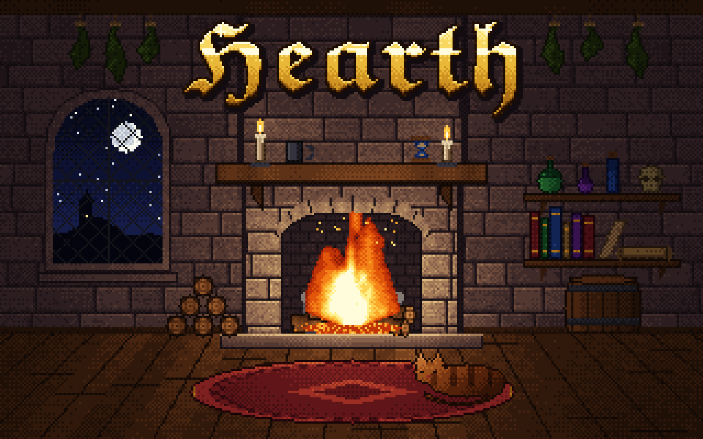

<p align="center">
  
</p>

Hearth is a small virtual machine monitor for Linux KVM, written in Rust
from scratch. It boots Linux on x86_64 and aarch64, and on x86 it also runs
bare-metal Doom.

## Devices

| | x86_64 | aarch64 |
|---|---|---|
| Boot | PVH ELF (`vmlinux`), modules via `--initramfs` | `Image` with a device tree |
| Serial console | 16550 UART | UART |
| Block | virtio-blk (MMIO) | virtio-blk (MMIO) |
| Network | virtio-net (MMIO) on a tap | |
| Keyboard | i8042 (PS/2) | |
| Display | VGA mode 13h, served over VNC | |

The guest gets one vcpu.

## Building

```sh
cargo build
```

For aarch64, build the cross-compilation image once, then build inside it:

```sh
./docker-build.sh aarch64
./docker-run.sh aarch64
```

## Running

Boot a Linux kernel with a root disk; the serial console is your terminal:

```sh
./make-rootfs.sh rootfs.img
target/debug/hearth --kernel vmlinux --disk rootfs.img
```

Add networking with a tap device (`sudo ./make-tap.sh up`, then `--tap tap0`),
and a display and keyboard over VNC with `--vnc 127.0.0.1:5900`. VNC has no
authentication, so keep it on localhost or tunnel it.

`make-guest-kernel.sh` builds an x86_64 kernel with everything Hearth needs,
and `make-alpine-rootfs.sh` an Alpine rootfs for running containers.
`hearth --help` lists every option.

## Doom

`guests/doom` is doomgeneric with a small libc and a PVH entry stub, drawing
to VGA mode 13h and reading the PS/2 keyboard:

```sh
cargo build
make -C guests/doom run
```

then connect a VNC client to 127.0.0.1:5900 (`make run VNC=...` to change
it). The Makefile fetches doomgeneric and Freedoom into `build/`.
